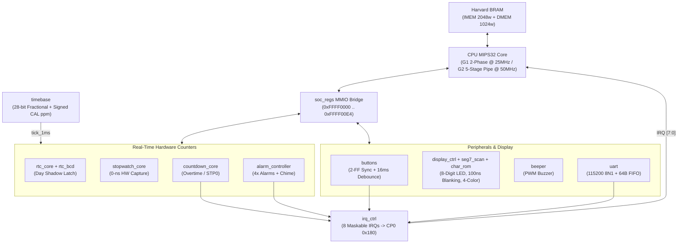
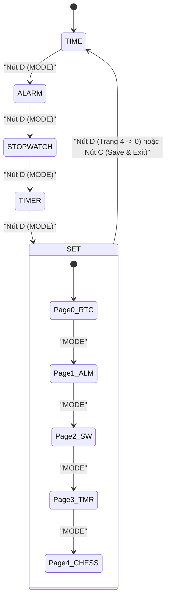
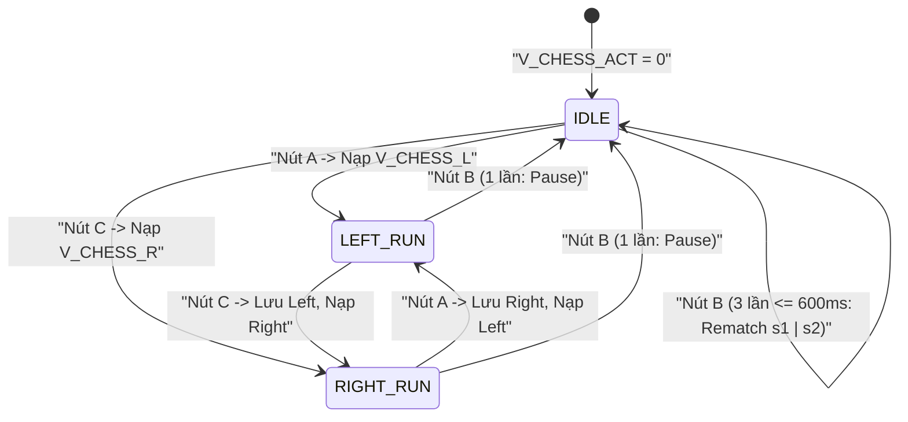
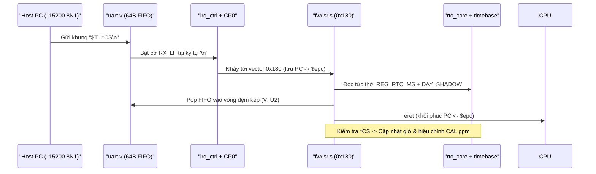

# WatchChip SoC: Bộ Xử Lý MIPS 32-bit & Vi Mạch Đồng Hồ Số Đa Chức Năng

> **Học phần:** MI4344 / IT3283 – Kiến trúc Máy tính (HUST - SAMI/SoICT)  
> **Đồ án:** Thiết kế Vi mạch Hệ thống (SoC) Đồng hồ Điện tử Tự động Chuẩn xác đến Millisecond bằng Verilog HDL và Hợp ngữ MIPS 32-bit  
> **Kiến trúc CPU:** MIPS 32-bit Đơn chu kỳ 2 pha (G1) và Pipeline 5 tầng có bộ giải quyết xung đột (G2)  
> **Nền tảng kiểm thử:** Icarus Verilog (`iverilog`), GTKWave, Co-simulation ISS (Instruction Set Simulator bằng Python)

> [!TIP]
> **Trải nghiệm Demo Trực Tiếp Không Cần Cài Đặt (Zero-Install Interactive Web Demo):**  
> Nhấp đúp mở ngay tệp [`demo_clock.html`](demo_clock.html) trong trình duyệt web bất kỳ để tương tác trực quan với mô hình đồng hồ LED 7 thanh thời gian thực, thử nghiệm đầy đủ 5 chế độ hoạt động, âm thanh còi bíp Web Audio và quan sát trực tiếp thanh ghi phần cứng MMIO mà không cần cài đặt bất kỳ công cụ nào!

---

## MỤC LỤC
1. [Tổng quan Đồ án & Bài toán Đồng thiết kế Phần cứng / Phần mềm](#1-tổng-quan-đồ-án--bài-toán-đồng-thiết-kế-phần-cứng--phần-mềm)
2. [Cơ sở Lý thuyết & Công thức Toán học Định lượng](#2-cơ-sở-lý-thuyết--công-thức-toán-học-định-lượng)
   - 2.1. Phương trình Hiệu năng CPU (CPU Performance Equation)
   - 2.2. Định luật Amdahl & Tăng tốc Khối Số học Phần cứng
   - 2.3. Giải thuật Chia Phục hồi Số dư 32 Chu kỳ (Restoring Division)
   - 2.4. Giải thuật Đổi Nhị phân sang BCD Tuần tự (Double-Dabble)
   - 2.5. Giải quyết Xung đột Đường ống Pipeline 5 tầng & Chuyển tiếp Dữ liệu (Forwarding)
   - 2.6. Hiệu chỉnh Tần số Trôi Tinh thể PPM (Fractional Timebase Calibration)
   - 2.7. Cơ chế Chống Bóng ma Hiển thị LED 7 Đoạn (Anti-Ghosting Blanking)
   - 2.8. Số học Bù Hai trong Đếm Quá Giờ Âm (Two's Complement Overtime)
3. [Kiến trúc Phần cứng Vi mạch SoC (Hardware Architecture)](#3-kiến-trúc-phần-cứng-vi-mạch-soc-hardware-architecture)
   - 3.1. Sơ đồ Khối Tổng thể Hệ thống
   - 3.2. Không gian Địa chỉ Ánh xạ Bộ nhớ (MMIO Memory Map)
   - 3.3. Tập Lệnh MIPS 28 Lệnh Hỗ trợ
4. [Hướng dẫn Sử dụng 5 Chế độ Hoạt động (Operating Modes)](#4-hướng-dẫn-sử-dụng-5-chế-độ-hoạt-động-operating-modes)
   - 4.1. Chế độ TIME (Xem Giờ Thực 4 Views & 4 Màu LED)
   - 4.2. Chế độ ALARM (4 Kênh Báo Thức, Chuông Giờ & Thời Lượng)
   - 4.3. Chế độ STOPWATCH (Bấm Giờ Thể Thao 9/99 Laps, SPLIT/GAP)
   - 4.4. Chế độ TIMER (Đếm Lùi Đơn & Cờ Vua Kép Tối Đa 99 Phút)
   - 4.5. Chế độ SET (Hệ Thống Cài Đặt 5 Trang & Lịch Năm Nhuận Gregorian)
5. [Kiến trúc Phần mềm Nhúng (Firmware Architecture)](#5-kiến-trúc-phần-mềm-nhúng-firmware-architecture)
   - 5.1. Cấu trúc Module Hợp ngữ
   - 5.2. Cơ chế Ngắt Coprocessor 0 & Xử lý Gói tin NTP UART
6. [Bản đồ Cấu trúc Mã nguồn (Project Directory Map)](#6-bản-đồ-cấu-trúc-mã-nguồn-project-directory-map)
7. [Hướng dẫn Cài đặt, Biên dịch & Kiểm thử (Verification Guide)](#7-hướng-dẫn-cài-đặt-biên-dịch--kiểm-thử-verification-guide)
   - 7.1. Yêu cầu Môi trường
   - 7.2. Lệnh Chạy Kiểm thử Tự động
   - 7.3. Kết quả Kiểm thử Toàn diện (Regression Test Results)
8. [Phân công Nhiệm vụ & Bản đồ Đóng góp (Role Matrix)](#8-phân-công-nhiệm-vụ--bản-đồ-đóng-góp-role-matrix)

---

## 1. TỔNG QUAN ĐỒ ÁN & BÀI TOÁN ĐỒNG THIẾT KẾ PHẦN CỨNG / PHẦN MỀM

### 1.1. Bối cảnh & Mục tiêu Kỹ thuật
Trong các hệ thống nhúng điều khiển thời gian thực (Real-Time Embedded Systems), đồng hồ số chính xác cao đòi hỏi khả năng phản hồi tức thời đối với các sự kiện bên ngoài (bấm nút ghi vòng chạy, phát chuông báo, đồng bộ xung nhịp từ trạm chủ) mà không làm suy giảm hiệu năng xử lý tác vụ của CPU.

Đồ án **WatchChip SoC** hiện thực hóa trọn vẹn một hệ thống vi mạch trên chip (SoC) hoàn chỉnh, từ lõi vi xử lý MIPS 32-bit tùy biến đến các ngoại vi chuyên dụng và phần mềm nhúng (firmware) hợp ngữ, giải quyết triệt để bài toán đồng thiết kế phần cứng / phần mềm (Hardware/Software Co-design).



### 1.2. Câu hỏi Cốt lõi: Phần cứng vs. Phần mềm trong Đo đạc Thời gian Thực
> **Vấn đề đặt ra:** *Để đồng hồ đạt độ chuẩn xác đến 1 millisecond (ms), thành phần nào bắt buộc phải là phần cứng chuyên dụng, và thành phần nào có thể giao cho phần mềm (CPU) đảm nhiệm?*

Nhóm đã thực hiện đo đạc định lượng thực tế thông qua thí nghiệm kiểm chứng `exp_e3_tb.v`:
* **Phương án Phần mềm (Software Polling):** CPU chạy vòng lặp đọc trạng thái phím bấm qua bus MMIO để ghi nhận thời điểm Lap. Do chu kỳ vòng lặp, việc chia sẻ thời gian cho quét LED và trễ xử lý ngắt, độ trễ bắt sự kiện dao động trong khoảng **$\Delta T \approx 0.1\text{ ms} \dots 1.36\text{ ms}$**, gây sai số tích lũy lớn khi bấm giờ thể thao.
* **Phương án Phần cứng Chuyên dụng (Hardware Capture):** Thiết kế thanh ghi chốt phần cứng (`stopwatch_core.v`) kích hoạt trực tiếp từ sườn xung của nút bấm (đã qua mạch đồng bộ và khử rung 2 tầng flip-flop). Kết quả: **Độ trễ bắt thời gian $\Delta T = 0\text{ ns}$ (bằng đúng 0 chu kỳ trễ phần mềm)**. Giá trị mili-giây được đóng băng ngay tại chu kỳ xung nhịp xảy ra sự kiện, hoàn toàn miễn nhiễm với trạng thái bận của CPU.

---

## 2. CƠ SỞ LÝ THUYẾT & CÔNG THỨC TOÁN HỌC ĐỊNH LƯỢNG

### 2.1. Phương trình Hiệu năng CPU (CPU Performance Equation)
Thời gian thực thi của chương trình trên bộ vi xử lý được xác định bởi phương trình kinh điển Patterson & Hennessy:

$$t_{CPU} = \frac{IC \times CPI}{f_{clk}} = IC \times CPI \times T_{clk}$$

Trong đó:
* $IC$ (Instruction Count): Tổng số lệnh thực thi của chương trình.
* $CPI$ (Cycles Per Instruction): Số chu kỳ xung nhịp trung bình để thực thi một lệnh.
* $f_{clk}$ ($T_{clk}$): Tần số (chu kỳ) xung nhịp hệ thống.

**So sánh định lượng giữa hai kiến trúc CPU trong WatchChip:**
1. **Lõi Đơn chu kỳ 2 pha (G1 Core):**
   * $CPI_{G1} = 1.0$ (Mỗi lệnh hoàn tất trong đúng 1 chu kỳ CPU gồm 2 pha xung nhịp).
   * Đường trễ tới hạn dài do tín hiệu đi xuyên qua IMEM $\rightarrow$ Giải mã $\rightarrow$ ALU $\rightarrow$ DMEM $\rightarrow$ Ghi thanh ghi trong cùng 1 chu kỳ. Tần số tối đa đạt được: $f_{max, G1} \approx 25\text{ MHz}$ ($T_{clk, G1} = 40\text{ ns}$).
2. **Lõi Đường ống 5 tầng (G2 Pipeline Core):**
   * Chia nhỏ đường dữ liệu thành 5 công đoạn: IF, ID, EX, MEM, WB, rút ngắn đường trễ tới hạn. Tần số tối đa tăng gấp đôi: $f_{max, G2} \approx 50\text{ MHz}$ ($T_{clk, G2} = 20\text{ ns}$).
   * Do xuất hiện các xung đột (hazards) gây dừng đường ống (stall), $CPI_{G2} \approx 1.25$.
   * **Hệ số tăng tốc (Speedup):**
     $$S = \frac{t_{CPU, G1}}{t_{CPU, G2}} = \frac{IC \times CPI_{G1} \times T_{clk, G1}}{IC \times CPI_{G2} \times T_{clk, G2}} = \frac{1.0 \times 40\text{ ns}}{1.25 \times 20\text{ ns}} = \frac{40}{25} = 1.6\times$$
     Lõi G2 mang lại hiệu năng cao hơn $60\%$ so với lõi G1.

---

### 2.2. Định luật Amdahl & Tăng tốc Khối Số học Phần cứng
Định luật Amdahl xác định giới hạn gia tốc hệ thống khi cải tiến một khối thành phần:

$$S_{latency} = \frac{1}{(1 - p) + \frac{p}{s}}$$

Trong đó:
* $p$: Tỷ lệ thời gian chương trình dành cho tác vụ được tăng tốc.
* $s$: Hệ số tăng tốc của riêng tác vụ đó.

**Thực nghiệm trên WatchChip:**
Trong firmware đồng hồ, tác vụ chuyển đổi thời gian dạng nhị phân sang định dạng hiển thị thập phân BCD (để xuất ra LED 7 đoạn) chiếm tới $p \approx 78\%$ tổng số chu kỳ CPU nếu thực hiện thuần túy bằng phần mềm (dùng thuật toán chia lặp 6 lần để bóc tách từng chữ số hàng chục, hàng đơn vị).
* **Nếu dùng phép chia phần mềm:** Mỗi phép chia 32-bit cần 32 chu kỳ $\times 6$ lần $= 192$ chu kỳ CPU.
* **Nếu bổ sung khối phần cứng `bcd_unit` (Double-Dabble) và `muldiv`:** Thực hiện chuyển đổi trực tiếp trong $28$ chu kỳ phần cứng, giảm thời gian chuyển đổi từ 192 chu kỳ xuống 28 chu kỳ ($s = \frac{192}{28} \approx 6.86\times$).
* **Gia tốc tổng thể toàn bộ firmware:**
  $$S_{overall} = \frac{1}{(1 - 0.78) + \frac{0.78}{6.86}} = \frac{1}{0.22 + 0.1137} = \frac{1}{0.3337} \approx 3.0\times$$
  Toàn bộ hệ thống chạy nhanh gấp 3 lần chỉ nhờ tích hợp khối BCD và bộ chia phần cứng.

---

### 2.3. Giải thuật Chia Phục hồi Số dư 32 Chu kỳ (Restoring Division)
Khối `muldiv.v` sử dụng thuật toán chia phục hồi số dư nhị phân không dấu (Unsigned Restoring Division) trên 32 chu kỳ xung nhịp để tính thương $Q = A / B$ và số dư $R = A \pmod B$:

**Công thức toán học:**
$$A = Q \times B + R \quad (0 \le R < B)$$

**Máy trạng thái phần cứng 32 bước:**
1. Khởi tạo thanh ghi ghép đôi 64-bit: $R = 0$, $Q = A$ (Số bị chia), $B$ (Số chia).
2. Lặp 32 chu kỳ (ứng với $i = 31 \dots 0$):
   * Dịch trái thanh ghi ghép đôi 1 bit:
     $$\{R, Q\} \leftarrow \{R, Q\} \ll 1$$
   * Thử trừ số chia khỏi phần dư tạm thời:
     $$R_{trial} = R - B$$
   * Kiểm tra dấu kết quả trừ:
     $$\begin{cases}
     R_{trial} \ge 0: & R \leftarrow R_{trial}; \quad Q[0] \leftarrow 1 \quad (\text{Accept}) \\
     R_{trial} < 0: & R \leftarrow R; \quad Q[0] \leftarrow 0 \quad (\text{Restore})
     \end{cases}$$
3. Sau 32 chu kỳ, thanh ghi $Q$ chứa Thương số chính xác và $R$ chứa Số dư, sẵn sàng chốt vào cặp thanh ghi `$lo` và `$hi`.

---

### 2.4. Giải thuật Đổi Nhị phân sang BCD Tuần tự (Double-Dabble)
Khối `bcd_unit.v` chuyển đổi số nhị phân 27-bit (giá trị thời gian tối đa trong ngày $86.399.999\text{ ms}$) thành 8 chữ số BCD (mỗi chữ số 4-bit, tổng cộng 32-bit: `HH:MM:SS.d`):

**Nguyên lý toán học:**
Trong hệ nhị phân, dịch trái 1 bit tương đương với phép nhân 2 ($x \rightarrow 2x$).
Trong hệ thập phân (BCD), mỗi nibble 4-bit chỉ có giá trị từ $0 \dots 9$. Khi dịch trái, nếu giá trị ban đầu $\ge 5$, giá trị mới sau khi dịch sẽ là $2x \ge 10$, vượt quá giới hạn biểu diễn của một nibble BCD (tràn sang nibble kế tiếp với trọng số 16 thay vì 10).
Do chênh lệch giữa cơ số 16 và cơ số 10 là $16 - 10 = 6$, giải thuật thực hiện cộng thêm 3 **trước khi dịch**:

$$(x + 3) \times 2 = 2x + 6$$

Phần $+6$ này sẽ bù trừ chính xác phần chênh lệch khi bit nhớ tràn sang chữ số hàng chục kế tiếp.

**Quy trình giải thuật tuần tự 27 bước:**
```
Khởi tạo: BCD_REG = 32'h0, BIN_REG = Binary_Input[26:0]
Lặp i từ 1 đến 27:
   Duyệt qua từng nibble BCD (chữ số k từ 0 đến 7):
      Nếu BCD_REG[4k+3 : 4k] >= 5:
         BCD_REG[4k+3 : 4k] = BCD_REG[4k+3 : 4k] + 3
   Dịch trái toàn bộ thanh ghi ghép đôi:
      {BCD_REG, BIN_REG} = {BCD_REG, BIN_REG} << 1
Hoàn tất sau 27 chu kỳ: BCD_REG chứa 8 chữ số BCD chuẩn xác.
```

---

### 2.5. Giải quyết Xung đột Đường ống Pipeline 5 tầng & Chuyển tiếp Dữ liệu (Forwarding)
Khối `hazard.v` trong lõi CPU G2 giám sát toàn diện 3 dạng xung đột đường ống (Hazards):

#### A. Xung đột Cấu trúc (Structural Hazard)
Được triệt tiêu hoàn toàn nhờ kiến trúc Harvard phân tách bộ nhớ lệnh độc lập (IMEM) và bộ nhớ dữ liệu độc lập (DMEM). Công đoạn IF (đọc lệnh) và công đoạn MEM (đọc/ghi dữ liệu) diễn ra đồng thời mà không tranh chấp bus.

#### B. Xung đột Dữ liệu & Mạch Chuyển tiếp Tắt (Data Hazard & Forwarding Unit)
Xảy ra khi một lệnh ở công đoạn sau cần đọc thanh ghi mà lệnh ở công đoạn trước đang tính toán và chưa kịp ghi ngược về tập thanh ghi (WB stage).

Mạch Forwarding so sánh chỉ số thanh ghi nguồn ($Rs, Rt$) của tầng EX với chỉ số thanh ghi đích ($Rd$) của tầng EX/MEM và MEM/WB:
1. **Chuyển tiếp từ tầng EX/MEM sang tầng EX (EX Hazard):**
   $$ForwardA = 2'b10 \iff (RegWrite_{EX/MEM} \land Rd_{EX/MEM} \ne 0 \land Rd_{EX/MEM} = Rs_{ID/EX})$$
   $$ForwardB = 2'b10 \iff (RegWrite_{EX/MEM} \land Rd_{EX/MEM} \ne 0 \land Rd_{EX/MEM} = Rt_{ID/EX})$$
2. **Chuyển tiếp từ tầng MEM/WB sang tầng EX (MEM Hazard):**
   $$ForwardA = 2'b01 \iff (RegWrite_{MEM/WB} \land Rd_{MEM/WB} \ne 0 \land \neg(\text{EX Hazard}) \land Rd_{MEM/WB} = Rs_{ID/EX})$$
   $$ForwardB = 2'b01 \iff (RegWrite_{MEM/WB} \land Rd_{MEM/WB} \ne 0 \land \neg(\text{EX Hazard}) \land Rd_{MEM/WB} = Rt_{ID/EX})$$

#### C. Xung đột Tải Dữ liệu (Load-Use Hazard Stall)
Lệnh `lw` chỉ có dữ liệu hợp lệ sau khi kết thúc công đoạn MEM. Do đó, nếu lệnh kế tiếp ngay sau `lw` cần sử dụng dữ liệu vừa nạp, phần cứng bắt buộc phải tạm dừng (stall) đường ống 1 chu kỳ:

$$\text{Stall} \iff MemRead_{ID/EX} \land (Rt_{ID/EX} = Rs_{IF/ID} \lor Rt_{ID/EX} = Rt_{IF/ID})$$

Khi phát hiện điều kiện trên:
* Đóng băng tầng IF/ID: Giữ nguyên $PC$ và thanh ghi $IF/ID$ (không nạp lệnh mới).
* Chèn một bọt bong bóng (bubble / NOP) vào tầng tử $ID/EX$ bằng cách đặt toàn bộ tín hiệu điều khiển bằng 0.

#### D. Xung đột Điều khiển (Control Hazard)
* Lệnh rẽ nhánh (`beq`, `bne`) được giải quyết sớm ngay tại tầng Giải mã (ID stage) nhờ bộ so sánh nhanh và bộ cộng địa chỉ nhánh riêng biệt.
* Thiết kế áp dụng **Kỳ hạn Rẽ nhánh (Branch Delay Slot)**: Lệnh nằm ngay sau lệnh nhánh luôn được thực thi, giúp triệt tiêu hoàn toàn tổn thất chu kỳ lãng phí (Branch penalty $= 0$ chu kỳ).

---

### 2.6. Hiệu chỉnh Tần số Trôi Tinh thể PPM (Fractional Timebase Calibration)
Xung nhịp chuẩn của bộ dao động thạch anh trên bo mạch thường có sai số vật lý do nhiệt độ và dung sai chế tạo ($\pm 20 \dots \pm 100\text{ ppm}$).

Khối `timebase.v` sử dụng bộ đếm tích lũy phân số 28-bit (Fractional Accumulator) để bù trừ độ trôi tần số với độ phân giải cực cao:
* Tần số hệ thống: $f_{clk} = 50\text{ MHz} \implies 50.000$ chu kỳ cho mỗi $1\text{ ms}$.
* Thanh ghi hiệu chỉnh $CAL$ là số nguyên bù hai 16-bit mang dấu, tương ứng với độ lệch tần số tính theo phần triệu (Parts Per Million - PPM).

Khi đồng bộ với máy tính chủ qua gói tin NTP trên cổng UART:
* Gọi $I$ là khoảng cách giữa 2 lần đồng bộ liên tiếp (tính bằng ms).
* Gọi $D$ là lượng thời gian trôi đo được giữa đồng hồ SoC và trạm chuẩn (tính bằng ms, $D > 0$ là chạy nhanh, $D < 0$ là chạy chậm).

**Công thức xác định giá trị thanh ghi $CAL$:**
$$CAL = \frac{D \times 2^{27}}{I}$$

Phần cứng tự động điều chỉnh chu kỳ nạp của bộ đếm $1\text{ ms}$ theo từng nhịp, triệt tiêu hoàn toàn sai số tích lũy dài hạn.

---

### 2.7. Cơ chế Chống Bóng ma Hiển thị LED 7 Đoạn (Anti-Ghosting Blanking)
Mạch quét hiển thị đa hợp 8 LED 7 đoạn (`seg7_scan.v`) kích hoạt tuần tự từng chữ số (Anode) với tần số quét xấp xỉ $1\text{ kHz}$ ($125\text{ Hz}$ toàn khung hình, triệt tiêu hiện tượng nhấp nháy quang học).

Tuy nhiên, do điện dung ký sinh trên các đường mạch in và thời gian phục hồi của bóng bán dẫn điều khiển LED, việc chuyển mạch đột ngột giữa Anode $k$ và Anode $k+1$ sẽ gây ra hiện tượng **bóng ma (Ghosting)** (hình ảnh của chữ số trước hiển thị mờ đè lên chữ số sau).

**Giải pháp phần cứng:**
Phần cứng chèn một khoảng làm tối cưỡng bức (**Blanking Interval**) kéo dài $100\text{ ns}$ (tương ứng 5 chu kỳ clock $50\text{ MHz}$) tại mỗi thời điểm chuyển đổi khe quét (khóa toàn bộ LED trong $100\text{ ns}$):
$$Anode[7:0] = \text{8'h00} \quad (\Delta t_{\text{blank}} = 100\text{ ns})$$
Sau khi điện tích ký sinh tiêu tán hoàn toàn, Anode mới được kích hoạt cùng dữ liệu đoạn tương ứng, mang lại hình ảnh hiển thị sắc nét tuyệt đối.

---

### 2.8. Số học Bù Hai trong Đếm Quá Giờ Âm (Two's Complement Overtime)
Khối `countdown_core.v` khi đếm ngược từ thời gian đặt trước về $0$ sẽ phát tín hiệu ngắt kích hoạt còi báo thức. Nếu người dùng không bật chế độ `STP0` (Dừng tại 0) và chưa nhấn nút dừng, bộ đếm không dừng lại mà tiếp tục đếm xuống các giá trị âm (Overtime Counter).

* Giá trị đếm được lưu dưới dạng số nguyên bù hai 32-bit (khi $VAL < 0$, giá trị hiển thị lấy trị tuyệt đối):
  $$|VAL| = -VAL = (\sim VAL) + 1$$
* Giá trị độ lớn $|VAL|$ được đưa vào bộ chuyển đổi BCD để hiển thị lên 7 LED bên phải, đồng thời bit dấu được dùng để bật cố định ký tự dấu trừ `-` (`CHAR_DASH = 5'h19`, đoạn g) tại ô ngoài cùng bên trái (`DISP7`).

---

## 3. KIẾN TRÚC PHẦN CỨNG VI MẠCH SOC (HARDWARE ARCHITECTURE)

### 3.1. Sơ đồ Khối Chi tiết Toàn Hệ Thống
```
+=============================================================================+
|                                WATCHCHIP SOC TOP                            |
|                                                                             |
|  +--------------------+         32-bit Central Data Bus                     |
|  |    CPU MIPS Core   |<================================================+   |
|  |  (G1 Single-Cycle/ |                                                 |   |
|  |   G2 5-Stage Pipe) |<-----+ IRQ Line [7:0]                           |   |
|  +--------------------+      |                                          |   |
|          |                   |                                          |   |
|          | Memory / MMIO     |                                          |   |
|          v                   |                                          |   |
|  +--------------------+      |                                          |   |
|  |    soc_regs.v      |------+                                          |   |
|  | Central MMIO Mux   |                                                 |   |
|  +--------------------+                                                 |   |
|    |   |   |   |   |                                                    |   |
|    |   |   |   |   +--> [0x80..0x84] buttons.v (4 Debounced Keys)       |   |
|    |   |   |   +------> [0x90..0x94] irq_ctrl.v (8 Maskable IRQs)       |   |
|    |   |   +----------> [0xA0..0xCC] display_ctrl.v + seg7_scan.v       |   |
|    |   |                (8-digit 7-Seg, Blanking, PWM Dimming) -------->|LED|
|    |   +--------------> [0xD0..0xD4] beeper.v (PWM Buzzer Out) -------->|SPK|
|    +------------------> [0xE0..0xE4] uart.v (115200 8N1 FIFO) --------->|COM|
|                                                                         |   |
|  +-------------------------------------------------------------------+  |   |
|  |                  REAL-TIME SUB-SYSTEM                             |  |   |
|  |  timebase.v ----> rtc_core.v (BCD & Day Shadow Latches)           |  |   |
|  |  (Signed CAL) ---> stopwatch_core.v (0-ns Hardware Capture 8 Laps)|  |   |
|  |               --> countdown_core.v (Negative Overtime Counter)    |  |   |
|  |               --> alarm_controller.v (4 Channels & Chime)         |  |   |
|  +-------------------------------------------------------------------+  |   |
+=============================================================================+
```

---

### 3.2. Không gian Địa chỉ Ánh xạ Bộ nhớ (MMIO Memory Map)
Toàn bộ thanh ghi cấu hình phần cứng được ánh xạ vào dải địa chỉ MMIO bắt đầu từ `0xFFFF0000`:

| Địa chỉ Tuyệt đối | Tên Thanh Ghi | Truy cập | Chức Năng Kỹ Thuật |
| :--- | :--- | :---: | :--- |
| `0xFFFF0000` | `REG_CYCLE_LO` | R | Bộ đếm chu kỳ thực thi 32-bit thấp của hệ thống |
| `0xFFFF0004` | `REG_CYCLE_HI` | R | Bộ đếm chu kỳ thực thi 32-bit cao của hệ thống |
| `0xFFFF0008` | `REG_CAL` | R/W | Giá trị hiệu chỉnh tần số thạch anh có dấu (PPM) |
| `0xFFFF000C` | `REG_CPU_DIV` | R/W | Bộ chia tần số xung nhịp cấp cho CPU ($D \ge 1$) |
| `0xFFFF0010` | `REG_RTC_MS` | R/W | Mili-giây trong ngày ($0 \dots 86.399.999$), chốt `DAY_SHADOW` |
| `0xFFFF0014` | `REG_DAY_SHADOW` | R/W | Ngày kể từ mốc epoch và thứ trong tuần (chốt đồng thời) |
| `0xFFFF0018` | `REG_RTC_CTRL` | R/W | Bit 0 (`ARM`): Kích hoạt nạp giá trị RTC mới |
| `0xFFFF001C` | `REG_RTC_BCD` | R | Giá trị thời gian đọc trực tiếp dạng BCD phần cứng |
| `0xFFFF0020` | `REG_SW_MS` | R | Thời gian bấm giờ hiện tại (mili-giây) |
| `0xFFFF0024` | `REG_SW_CTRL` | R/W | Điều khiển Bấm giờ: Bit 0 (Run/Stop), Bit 1 (Clear) |
| `0xFFFF0028` .. `+0x1C` | `REG_SW_LAP0`..`LAP7` | R | 8 thanh ghi chốt thời gian vòng chạy (0-ns capture) |
| `0xFFFF0050` | `REG_TMR_VAL` | R | Thời gian đếm ngược còn lại (hỗ trợ số âm bù hai) |
| `0xFFFF0054` | `REG_TMR_PRE` | R/W | Giá trị thời gian đặt trước cho bộ đếm ngược (ms) |
| `0xFFFF0058` | `REG_TMR_CTRL` | R/W | Bit 0 (Run/Stop), Bit 1 (Reload), Bit 2 (Auto-Buzzer) |
| `0xFFFF0060` .. `+0x0C` | `REG_AL1`..`AL4` | R/W | 4 kênh đặt giờ báo thức (Bit 31: Enable, Bit 26..0: ms) |
| `0xFFFF0070` | `REG_AL_HIT` | R/W1C | Cờ báo khớp thời gian của các kênh báo thức |
| `0xFFFF0080` | `REG_BTN_EDGE` | R/W1C | Cờ phát hiện sườn nhấn nút (A, B, C, D) đã khử rung |
| `0xFFFF0084` | `REG_BTN_PRESS` | R | Trạng thái mức logic tức thời của 4 nút bấm |
| `0xFFFF0090` | `REG_IRQ_STATUS` | R | Trạng thái cờ ngắt đang chờ phục vụ (8 kênh) |
| `0xFFFF0094` | `REG_IRQ_ENABLE` | R/W | Mặt nạ cho phép/cấm từng kênh ngắt ngoại vi |
| `0xFFFF00A0` .. `+0x1C` | `DISP0` .. `DISP7` | R/W | Mã ký tự hiển thị trên 8 ô LED 7 đoạn |
| `0xFFFF00C0` | `REG_BLINK_MASK` | R/W | Mặt nạ điều khiển nhấp nháy 2 Hz cho từng ô LED |
| `0xFFFF00C4` | `REG_BRIGHTNESS` | R/W | Độ sáng màn hình LED điều chế PWM (0 đến 15) |
| `0xFFFF00D0` | `REG_BEEP_PERIOD` | R/W | Chu kỳ tần số phát âm thanh của còi Buzzer |
| `0xFFFF00D4` | `REG_BEEP_CTRL` | R/W | Điều khiển thời lượng phát và chu kỳ công tác còi |
| `0xFFFF00E0` | `REG_UART_DATA` | R/W | Đệm phát/nhận dữ liệu nối tiếp UART |
| `0xFFFF00E4` | `REG_UART_STATUS` | R | Cờ trạng thái UART: Bit 0 (`TX_READY`), Bit 1 (`RX_VALID`) |

---

### 3.3. Tập Lệnh MIPS 28 Lệnh Hỗ trợ
Bộ vi xử lý tích hợp 28 lệnh MIPS chuẩn, đáp ứng hoàn hảo cho firmware hệ thống:

| Tên Lệnh | Định Dạng | Opcode | Funct | Cú Pháp Hợp Ngữ | Thao Tác Ngữ Nghĩa (RTL Semantics) |
| :--- | :---: | :---: | :---: | :--- | :--- |
| `add` | R | `000000` | `100000` | `add $rd, $rs, $rt` | $R[rd] \leftarrow R[rs] + R[rt]$ (Có bẫy tràn số) |
| `addu` | R | `000000` | `100001` | `addu $rd, $rs, $rt` | $R[rd] \leftarrow R[rs] + R[rt]$ (Không bẫy tràn) |
| `sub` | R | `000000` | `100010` | `sub $rd, $rs, $rt` | $R[rd] \leftarrow R[rs] - R[rt]$ (Có bẫy tràn số) |
| `subu` | R | `000000` | `100011` | `subu $rd, $rs, $rt` | $R[rd] \leftarrow R[rs] - R[rt]$ (Không bẫy tràn) |
| `and` | R | `000000` | `100100` | `and $rd, $rs, $rt` | $R[rd] \leftarrow R[rs] \land R[rt]$ |
| `or` | R | `000000` | `100101` | `or $rd, $rs, $rt` | $R[rd] \leftarrow R[rs] \lor R[rt]$ |
| `xor` | R | `000000` | `100110` | `xor $rd, $rs, $rt` | $R[rd] \leftarrow R[rs] \oplus R[rt]$ |
| `nor` | R | `000000` | `100111` | `nor $rd, $rs, $rt` | $R[rd] \leftarrow \neg(R[rs] \lor R[rt])$ |
| `slt` | R | `000000` | `101010` | `slt $rd, $rs, $rt` | $R[rd] \leftarrow (R[rs] < R[rt]) ? 1 : 0$ (Có dấu) |
| `sltu` | R | `000000` | `101011` | `sltu $rd, $rs, $rt` | $R[rd] \leftarrow (R[rs] < R[rt]) ? 1 : 0$ (Không dấu) |
| `sll` | R | `000000` | `000000` | `sll $rd, $rt, shamt` | $R[rd] \leftarrow R[rt] \ll shamt$ |
| `srl` | R | `000000` | `000010` | `srl $rd, $rt, shamt` | $R[rd] \leftarrow R[rt] \gg shamt$ (Logic) |
| `sra` | R | `000000` | `000011` | `sra $rd, $rt, shamt` | $R[rd] \leftarrow R[rt] \gg shamt$ (Số học) |
| `sllv` | R | `000000` | `000100` | `sllv $rd, $rt, $rs` | $R[rd] \leftarrow R[rt] \ll R[rs][4:0]$ |
| `srlv` | R | `000000` | `000110` | `srlv $rd, $rt, $rs` | $R[rd] \leftarrow R[rt] \gg R[rs][4:0]$ |
| `srav` | R | `000000` | `000111` | `srav $rd, $rt, $rs` | $R[rd] \leftarrow R[rt] \gg R[rs][4:0]$ (Số học) |
| `jr` | R | `000000` | `001000` | `jr $rs` | $PC \leftarrow R[rs]$ |
| `mult` | R | `000000` | `011000` | `mult $rs, $rt` | $\{HI, LO\} \leftarrow R[rs] \times R[rt]$ |
| `div` | R | `000000` | `011010` | `div $rs, $rt` | $LO \leftarrow R[rs] / R[rt]; \quad HI \leftarrow R[rs] \pmod{R[rt]}$ |
| `mfhi` | R | `000000` | `010000` | `mfhi $rd` | $R[rd] \leftarrow HI$ |
| `mflo` | R | `000000` | `010010` | `mflo $rd` | $R[rd] \leftarrow LO$ |
| `addi` | I | `001000` | — | `addi $rt, $rs, imm` | $R[rt] \leftarrow R[rs] + \text{SignExt}(imm)$ |
| `addiu` | I | `001001` | — | `addiu $rt, $rs, imm` | $R[rt] \leftarrow R[rs] + \text{SignExt}(imm)$ |
| `andi` | I | `001100` | — | `andi $rt, $rs, imm` | $R[rt] \leftarrow R[rs] \land \text{ZeroExt}(imm)$ |
| `ori` | I | `001101` | — | `ori $rt, $rs, imm` | $R[rt] \leftarrow R[rs] \lor \text{ZeroExt}(imm)$ |
| `xori` | I | `001110` | — | `xori $rt, $rs, imm` | $R[rt] \leftarrow R[rs] \oplus \text{ZeroExt}(imm)$ |
| `lui` | I | `001111` | — | `lui $rt, imm` | $R[rt] \leftarrow \{imm, 16'h0\}$ |
| `lw` | I | `100011` | — | `lw $rt, offset($rs)` | $R[rt] \leftarrow Mem[R[rs] + \text{SignExt}(offset)]$ |
| `sw` | I | `101011` | — | `sw $rt, offset($rs)` | $Mem[R[rs] + \text{SignExt}(offset)] \leftarrow R[rt]$ |
| `beq` | I | `000100` | — | `beq $rs, $rt, label` | $\text{if } R[rs] = R[rt]: PC \leftarrow PC + 4 + \text{SignExt}(offset) \ll 2$ |
| `bne` | I | `000101` | — | `bne $rs, $rt, label` | $\text{if } R[rs] \ne R[rt]: PC \leftarrow PC + 4 + \text{SignExt}(offset) \ll 2$ |
| `j` | J | `000010` | — | `j target` | $PC \leftarrow \{PC[31:28], target, 2'b00\}$ |
| `jal` | J | `000011` | — | `jal target` | $R[31] \leftarrow PC + 8; \quad PC \leftarrow \{PC[31:28], target, 2'b00\}$ |
| `mfc0` | R | `010000` | `000000` | `mfc0 $rt, $rd` | Đọc thanh ghi đặc biệt Coprocessor 0 ($Status, Cause, EPC$) |
| `mtc0` | R | `010000` | `000000` | `mtc0 $rt, $rd` | Ghi thanh ghi đặc biệt Coprocessor 0 ($Status, Cause, EPC$) |
| `eret` | R | `010000` | `011000` | `eret` | Trở về từ chương trình phục vụ ngắt: $PC \leftarrow EPC$ |

---

## 4. HƯỚNG DẪN SỬ DỤNG 5 CHẾ ĐỘ HOẠT ĐỘNG (OPERATING MODES)

Thiết bị giao tiếp với người dùng thông qua **4 phím bấm vật lý (A, B, C, D)** và **màn hình 8 LED 7 đoạn**:
* **Phím D (MODE):** Phím chuyển chế độ (Mode Select), xoay vòng tuần tự theo triết lý thiết kế Casio chuẩn (`TIME (0) → ALARM (1) → STOPWATCH (2) → TIMER (3) → SET (4) → TIME (0)`):



---

### 4.1. Chế độ TIME (Xem Giờ Thực — 4 Kiểu Xem & 4 Màu LED)
* **Chức năng:** Hiển thị giờ hiện hành, lịch ngày đầy đủ và số tuần ISO từ khối RTC phần cứng.
* **Thao tác phím:**
  * **Phím A (Alarm Smash & Safety Global Off):**
    * **Nhấn 1 lần:** Tắt ngay lập tức còi báo thức / Hourly Chime đang kêu (Alarm Smash).
    * **Nhấn nhanh 3 lần liên tiếp** ($\Delta t \le 600\text{ ms}$): Kích hoạt/hủy khóa **Tắt Báo Thức Toàn Cục (Global Alarm Off)** cho đến khi người dùng vào lại trang Alarm để bật lại.
  * **Phím B:** Xoay vòng tuần tự **4 kiểu xem hiển thị**:
    1. **12h AM/PM (`AM HH:MM:SS` / `PM HH:MM:SS`):** Hiển thị đầy đủ `AM` / `PM` trên 2 chữ số ngoài cùng bên trái ($S_7 S_6$), theo sau bởi Giờ:Phút:Giây.
    2. **24h + Centi-giây (`HH:MM:SS.cs`):** Giờ:Phút:Giây 24h tích hợp thêm 2 chữ số mili-giây độ chính xác $0.01\text{ s}$ ($cs$).
    3. **Ngày tháng đầy đủ (`DD.MM.YYYY`):** Tận dụng trọn vẹn 8 LED hiển thị Ngày, Tháng và Năm 4 chữ số (ví dụ: `29.02.2024`).
    4. **Tuần & Thứ trong tuần (`W##  DOW`):** Hiển thị số tuần trong năm (`W01`..`W53`) ở 3 LED trái và tên thứ (`MON`, `TUE`, `WED`, `THU`, `FRI`, `SAT`, `SUN`) ở 3 LED phải (ví dụ: `W03  THU`).
  * **Phím C:** Chuyển đổi luân phiên **4 chủ đề màu LED** (`Đỏ` $\to$ `Xanh lá` $\to$ `Xanh lam` $\to$ `Vàng`).

---

### 4.2. Chế độ ALARM (4 Kênh Báo Thức Độc Lập, Chuông Giờ & Cấu Hình Thời Lượng)
Chế độ ALARM cung cấp khả năng quản lý 4 mốc báo thức độc lập (`AL1` đến `AL4`), chuông điểm giờ tròn tiếng (`CH` - Hourly Chime) và cấu hình thời lượng chuông thông qua các thanh ghi phần cứng `REG_ALARM0` đến `REG_ALARM3`.

* **4 Kênh Báo Thức Độc Lập (`AL1`, `AL2`, `AL3`, `AL4`):**
  * **Ý nghĩa:** Quản lý 4 mốc thời gian báo thức riêng biệt trong ngày (từ $00:00$ đến $23:59$), gán mặt nạ các ngày trong tuần.
  * **Định dạng hiển thị:** `ALk o HH:MM` (ví dụ `AL1o07:00`: kênh 1 đang **BẬT** với chữ `o` ở $S_4$; `AL2 12:30`: kênh 2 đang **TẮT**).
  * **Thao tác phím:**
    * **Phím A:** Bật / Tắt kích hoạt kênh báo thức hiện tại (hoặc `CH` Hourly Chime).
    * **Phím B:** Chuyển đổi vòng tròn giữa các kênh: `AL1` $\to$ `AL2` $\to$ `AL3` $\to$ `AL4` $\to$ `CH` $\to$ `AL1`.
    * **Phím C (khi không reo):** Vào chế độ chỉnh sửa giờ/phút báo thức. Nhấn Phím A để tăng giá trị (+1), Phím B để đổi giữa Giờ $\leftrightarrow$ Phút, Phím C để lưu lại.
    * **Phím C (khi chuông đang reo):** Kích hoạt **Snooze (+5 phút)** — tắt chuông tạm thời và tự động hẹn reo lại sau $300.000\text{ ms}$.
* **Thời lượng Chuông (Alarm Duration) & Tick Định Kỳ Chạy Giờ:**
  * Hỗ trợ cấu hình thời lượng chuông kéo dài (**5s / 10s / 30s / 60s**) cho Báo thức Mode 1, Hourly Chime và Countdown Timer khi chạm mốc 0 (Auto-Silence khi hết thời lượng).
  * **Tick Định Kỳ (Periodic Running Ticks):** Trong Mode 2 (Stopwatch) và Mode 3 (Timer), cho phép cấu hình chu kỳ phát tiếng bíp (`OFF / 1s / 2s / 5s / 10s / 20s / 30s / 60s / ...`) và số nhịp bíp mỗi lần kích hoạt (`1..5` bíp).
* **Chuông Điểm Giờ Tròn Tiếng (`CH` — Hourly Chime):**
  * Hiển thị `CH o    ` (BẬT) hoặc `CH      ` (TẮT). Tại giây `00` đầu mỗi giờ, phần cứng PWM beeper phát chuỗi bíp báo hiệu.

---

### 4.3. Chế độ STOPWATCH (Bấm Giờ Thể Thao 9/99 Laps, Giờ Live & SPLIT/GAP)
* **Chức năng:** Bấm giờ chính xác mili-giây, chốt tức thời ($\Delta T = 0\text{ ns}$) tại thanh ghi phần cứng `REG_SW_LAP`.
* **Hiển thị Live Running (`H:MM:SS.mmm`):**
  * Trong khi đồng hồ đang chạy trực tiếp (cho cả chế độ 9 Laps và 99 Laps), LED ngoài cùng bên trái ($S_7$) hiển thị **chữ số Giờ (0..9)** kèm dấu hai chấm `:` và đầy đủ **3 chữ số mili-giây** (`H:MM:SS.mmm`, tối đa `9:59:59.999`).
* **2 Chế độ Lưu Trữ & Đánh đổi Kiến trúc (Display & Resolution Trade-off):**
  $$N_{\text{ID}} + N_{\text{time}} = 8$$
  * **Chế độ `09L` (9 Laps @ 1 ms — `L MM:SS.mmm`):** Dành 1 LED ($S_7$) làm chỉ số vòng ($1 \dots 9$), 7 LED còn lại ($S_6 \dots S_0$) hiển thị đầy đủ Phút, Giây và Mili-giây độ phân giải $1\text{ ms}$. Vượt quá 9 mốc áp dụng bộ đệm trượt (Sliding Buffer) giữ lại 9 mốc mới nhất.
  * **Chế độ `99L` (99 Laps @ 10 ms — `LL MM:SS.cc`):** Lưu tới 99 vòng chạy trong ngăn xếp RAM (LIFO) với độ phân giải $0.01\text{ s}$ ($10\text{ ms}$); 2 LED ($S_7 S_6$) làm số thứ tự `01..99`, 6 LED ($S_5 \dots S_0$) hiển thị `MM:SS.cc`.
* **Tùy chọn Xem `SPL` (Split) vs `GAP` (Chênh lệch giữa các Lap):**
  * **`SPL` (Split Time):** Hiển thị mốc thời gian tuyệt đối tính từ lúc bắt đầu.
  * **`GAP` (Lap Delta):** Hiển thị khoảng thời gian chênh lệch giữa lap thứ $k$ và lap $k-1$ (với lap 1 so với 0), đồng thời **tắt toàn bộ các số 0 vô nghĩa ở đầu** (Leading Zero Blanking) giúp đọc nhanh thời gian từng chặng.
* **Thao tác phím bấm:**
  * **Phím A:** Bắt đầu chạy (Start) / Tạm dừng (Stop).
  * **Phím B:** Khi đang chạy $\to$ Chốt Lap vào Stack; Khi đang dừng $\to$ Đặt lại về `0:00:00.000` và xóa Stack.
  * **Phím C:** Khi dừng và chưa có Lap $\to$ Đổi trực tiếp `09L` $\leftrightarrow$ `99L`; Khi đã có Lap $\to$ Duyệt xem các mốc đã lưu ($1 \dots N \to \text{Live}$).

---

### 4.4. Chế độ TIMER (Đếm Lùi Đơn `t1` & Đồng Hồ Cờ Vua Kép `t2` 99 Phút)
Chế độ TIMER cung cấp 2 tiểu chế độ chuyên dụng phục vụ mọi tình huống đo đếm thời gian:

#### A. Tiểu chế độ `t1`: Đếm lùi Đơn (Single Timer)
* **Định dạng hiển thị thích ứng:**
  * **Khi thời gian $< 10\text{ h}$ (`absMs < 36.000.000 ms`):** Hiển thị `H:MM:SS.mmm` với chữ số Giờ ($0 \dots 9$) trên $S_7$ kèm dấu hai chấm `:`, dấu hai chấm giữa `MM` và `SS`, và dấu chấm `.` trước 3 chữ số mili-giây `mmm`.
  * **Khi thời gian $\ge 10\text{ h}$:** Tự động chuyển sang định dạng `__HH:MM:SS`.
  * **Khi quá giờ âm (Overtime):** Bật dấu trừ `-` tại ô ngoài cùng bên trái ($S_7$).
* **Tùy chọn Dừng tại 0 (`STP0`) & Tick Căn Chỉnh Mốc 0:**
  * **`STP0` (Stop at 0):** Cho phép chọn giữa **Đếm bù âm quá giờ** (mặc định) hoặc **Tự động dừng tại `0:00:00.000` và reo chuông báo thức** theo thời lượng đã cài đặt.
  * **Zero-Aligned Periodic Ticks:** Nhịp tick định kỳ trong chế độ đếm lùi luôn được căn chỉnh chia hết tới mốc `0` (bỏ qua bội số đầu tiên nếu tổng thời gian không chia hết chu kỳ tick).
* **Điều khiển an toàn (Fail-Safe Buttons):**
  * **Phím A:** Start / Resume (nhấn lặp lại khi đang chạy không gây tắt).
  * **Phím B (1 lần):** Tạm dừng tức thì (Pause).
  * **Phím B (3 lần nhanh $\le 600\text{ ms}$):** Reset an toàn về mốc trước khi chạy (`V_TMR_SNAP`) hoặc về 0.
  * **Phím C:** Tắt chuông báo động đang kêu **VÀ** tạm dừng đồng hồ ngay trong **1 lần nhấn duy nhất** (Atomic Silence & Pause).

#### B. Tiểu chế độ `t2`: Đồng Hồ Cờ Vua Kép (Chess Double Clock — Tối đa `99:59`)
* **Bố cục chia đôi 8 LED ($S_7 \dots S_0$):**
  * **Bên Trái ($S_7 S_6 S_5 S_4$):** Đồng hồ Đấu thủ A (Left Clock, cấu hình `s1`).
  * **Bên Phải ($S_3 S_2 S_1 S_0$):** Đồng hồ Đấu thủ C (Right Clock, cấu hình độc lập `s2` cho chấp giờ / Odds Matches).
  * Vì không cần trường Giờ, mỗi bên hỗ trợ giới hạn tối đa lên tới **99 phút 59 giây (`99:59`)**.
* **Định dạng Động 3 Cấp cho mỗi bên:**
  1. **Khi $\ge 1$ phút ($V \ge 60.000\text{ ms}$):** Hiển thị `MM:SS` (có dấu hai chấm `:` giữa Phút và Giây, hỗ trợ `01:00` đến `99:59`).
  2. **Khi $< 1$ phút dương ($0 \le V < 60.000\text{ ms}$):** Tự động chuyển thang đo sang centi-giây $0.01\text{ s}$ `SS.cc` với dấu chấm thập phân `.`.
  3. **Khi quá giờ âm ($V < 0$):** Hiển thị `-S.cc` (bão hòa tại `-9.99`s).
* **Bàn Phím Lật Đơn Chiều & Tái Đấu:**
  * **Phím A / C:** Ai bấm trước chạy trước; khi A đang chạy bấm C để chuyển lượt sang C (nhấn lặp lại C không lật ngược về A). Tương tự khi C đang chạy, bấm A để chuyển sang A.
  * **Phím B (1 lần):** Tạm dừng cả 2 đồng hồ; **Phím B (3 lần nhanh $\le 600\text{ ms}$):** Tái đấu (Rematch Reset) — khôi phục A về `s1` và C về `s2`.
* **Tái Sử Dụng Phần Cứng:** Toàn bộ 2 đồng hồ dùng chung 1 khối `countdown_core.v` duy nhất, CPU hoán đổi giá trị với DMEM khi đổi lượt (0 LUT/FF phát sinh thêm).



---

### 4.5. Chế độ SET (Hệ Thống Cài Đặt 5 Trang & Lịch Năm Nhuận Gregorian)
Chế độ SET hỗ trợ điều hướng tuần hoàn qua **5 trang cài đặt (`V_TPAGE = 0..4`)** với tín hiệu nhấp nháy $2\text{ Hz}$ trên trường đang sửa (`REG_BLINK_MASK`):

* **Trang 0 — SET RTC (`V_TPAGE = 0`):** Chỉnh Giờ (0..23), Phút (0..59), Giây (ép về 00), Ngày, Tháng, Năm (2000..2099).
  * **Thuật toán Năm Nhuận Gregorian chuẩn xác:** Năm nhuận khi chia hết cho 4 **nhưng không chia hết cho 100**, trừ trường hợp chia hết cho 400 (`(y % 4 == 0 && y % 100 != 0) || (y % 400 == 0)` — ví dụ 2000 nhuận, 1900/2100 không nhuận). Tự động kẹp ngày cuối tháng hợp lệ khi đổi tháng/năm.
* **Trang 1 — SET ALARM (`V_TPAGE = 1`):** Chỉnh kênh báo thức (`AL1`..`AL4`), Giờ và Phút (`ALk  HH:MM`).
* **Trang 2 — SET STOPWATCH (`V_TPAGE = 2`):** Hiển thị `09L  SPL` / `99L  GAP` — **Phím A** chọn Option A (`09L` vs `99L`), **Phím B** chọn Option B (`SPL` vs `GAP`), **Phím C** lưu và thoát về STOPWATCH.
* **Trang 3 — SET TIMER `s1` & Chế độ (`V_TPAGE = 3`):** Cài đặt thời gian đếm lùi `s1` và đảo tiểu chế độ `t1` (Single) $\leftrightarrow$ `t2` (Chess). Ở chế độ `t2`, Phút tăng từ `00` đến `99`.
* **Trang 4 — SET CHESS `s2` (`V_TPAGE = 4`):** Cài đặt mốc thời gian riêng `s2` cho Đấu thủ Phải (Clock C, hiển thị `C2  MM:SS`, Phút hỗ trợ từ `00` đến `99` cho ván tối đa 99m59s).
* **Điều hướng:** Nhấn phím **MODE (D)** duyệt vòng `Trang 0 → 1 → 2 → 3 → 4 → thoát về TIME`; nhấn **C** tại bất kỳ trang nào để **Save & Exit** về chế độ tương ứng.

---

## 5. KIẾN TRÚC PHẦN MỀM NHÚNG (FIRMWARE ARCHITECTURE)

### 5.1. Cấu trúc Module Hợp ngữ
Firmware được tổ chức theo kiến trúc phân tầng module hóa cao độ, liên kết chặt chẽ thông qua chỉ thị `.include`:

```
fw/
├── mmio.inc          # Định nghĩa hằng số địa chỉ MMIO dương (0xFFFF0000 base)
├── def.inc           # Định nghĩa biến toàn cục, ký tự ROM LED (0..9, M, W, G, -) và cờ
├── boot.s            # Khởi tạo phần cứng ban đầu, nạp RTC, cấu hình ngắt
├── fmt.s             # Thư viện định dạng BCD / LED 7 thanh dùng chung
├── isr.s             # Trình phục vụ ngắt tại vector 0x00000180 (chụp giờ gói UART)
├── time_mode.s       # FSM chế độ TIME: 4 views (12h AM/PM, 24h+cs, Date, Week/DOW), 4 màu LED
├── alarm_mode.s      # FSM chế độ ALARM: 4 kênh báo thức, Snooze, Chime, thời lượng chuông & tick
├── sw_mode.s         # FSM chế độ STOPWATCH: live H:MM:SS.mmm, 9/99 Laps, SPLIT/GAP blanking
├── timer_mode.s      # FSM chế độ TIMER: Single Timer (STP0/Overtime) & Chess Clock 99 phút
├── set_mode.s        # FSM chế độ SET: 5 trang cài đặt nhấp nháy 2 Hz, lịch năm nhuận Gregorian
├── uart_sync.s       # Giao thức đồng bộ NTP qua UART, giải thuật tính trôi CAL PPM
└── main.s            # Vòng lặp điều phối chính (Super-loop Router) & Quét hiển thị
```

### 5.2. Cơ chế Ngắt Coprocessor 0 & Xử lý Gói tin NTP UART
* **Vector ngắt:** Cố định tại địa chỉ `0x00000180`. Khi có ngắt, phần cứng lưu $PC$ hiện tại vào `$epc` và bật bit nguyên nhân ngắt trong `$cause`.
* **Đồng bộ thời gian UART NTP:**
  Khi máy tính chủ phát chuỗi định thời chuẩn dạng `$T...*CS\n`:
  1. Ngay khi ký tự ngắt dòng `\n` đi vào thanh ghi dịch UART, cờ ngắt phần cứng bật lên.
  2. Trình phục vụ ngắt (`fw/isr.s`) phản hồi tức thì trong vòng $8$ chu kỳ lệnh, đọc ngay lập tức giá trị `REG_RTC_MS` và `REG_DAY_SHADOW` để chốt mốc thời gian nhận gói với sai số $0\text{ ms}$.
  3. Firmware kiểm tra mã lỗi Checksum XOR (`*CS`). Nếu hợp lệ, hệ thống nạp lại giờ chuẩn và tính toán bù trừ độ trôi tần số $CAL$ cho bộ dao động.



---

## 6. BẢN ĐỒ CẤU TRÚC MÃ NGUỒN (PROJECT DIRECTORY MAP)

| Đường Dẫn Tệp | Vai Trò Chức Năng Kỹ Thuật |
| :--- | :--- |
| **`demo_clock.html`** | Ứng dụng Web mô phỏng tương tác trực tiếp 100% thời gian thực (Zero-install, chạy ngay trên trình duyệt) |
| **`src/alu.v`** | Khối số học & logic ALU 32-bit: cộng, trừ, and, or, xor, nor, so sánh slt/sltu, dịch bit |
| **`src/muldiv.v`** | Khối nhân 1 chu kỳ và bộ chia phục hồi số dư Restoring Division 32 chu kỳ |
| **`src/bcd_unit.v`** | Khối chuyển đổi nhị phân sang 8 chữ số BCD phần cứng (Double-Dabble 27 chu kỳ) |
| **`src/timebase.v`** | Bộ chia tần số phân số 28-bit tạo nhịp 1 ms, hỗ trợ hiệu chỉnh trôi tần số CAL signed PPM |
| **`src/rtc_core.v`** | Khối đồng hồ thời gian thực RTC: đếm mili-giây, ngày, thứ, hỗ trợ chốt bóng Day Shadow |
| **`src/stopwatch_core.v`** | Khối bấm giờ thể thao mili-giây, mảng chốt 8 vòng Lap phần cứng với trễ capture 0-ns |
| **`src/countdown_core.v`** | Khối đếm lùi hẹn giờ, kích còi khi về 0, tiếp tục đếm bù hai số âm quá giờ |
| **`src/alarm_controller.v`**| Bộ điều khiển 4 mốc báo thức độc lập và mạch phát hiện chuông báo đầu giờ |
| **`src/buttons.v`** | Mạch lọc nhiễu phím bấm 2 tầng Flip-Flop chống hiện tượng siêu ổn định (Metastability) |
| **`src/irq_ctrl.v`** | Bộ gom, tạo mặt nạ và điều khiển ưu tiên 8 kênh ngắt ngoại vi phần cứng |
| **`src/display_ctrl.v`** | Bộ đệm hiển thị 8 chữ số, điều khiển nhấp nháy 2 Hz và độ sáng PWM 16 mức |
| **`src/seg7_scan.v`** | Bộ quét đa hợp 8 LED 7 đoạn kèm khoảng làm tối 100 ns chống bóng ma |
| **`src/char_rom.v`** | Bảng tra ROM giải mã ký tự ASCII sang mã 7 thanh (hỗ trợ 0..9, A..F, M, W, G, - và ký hiệu UI) |
| **`src/beeper.v`** | Khối điều chế độ rộng xung PWM tạo âm thanh đa tần số cho còi Buzzer |
| **`src/uart.v`** | Bộ truyền nhận nối tiếp bất đồng bộ UART 115200 baud 8N1, tích hợp hàng đợi FIFO 64-byte |
| **`src/regfile.v`** | Tập 32 thanh ghi MIPS 32-bit: 2 cổng đọc bất đồng bộ, 1 cổng ghi đồng bộ tại sườn xung |
| **`src/control.v`** | Bộ giải mã điều khiển trung tâm 28 lệnh MIPS tạo các bus tín hiệu điều khiển datapath |
| **`src/hazard.v`** | Đơn vị phát hiện xung đột dữ liệu, điều khiển Forwarding và chèn bọt dừng Load-Use |
| **`src/cpu_g1.v`** | Lõi xử lý CPU MIPS Đơn chu kỳ sử dụng kỹ thuật xung nhịp 2 pha chống chạy đua dữ liệu |
| **`src/cpu_pipe.v`** | Lõi xử lý CPU MIPS Đường ống Pipeline 5 tầng (IF, ID, EX, MEM, WB) hiệu năng cao |
| **`src/soc_regs.v`** | Bộ giải mã trung tâm MMIO bus kết nối toàn bộ thanh ghi ngoại vi vào không gian địa chỉ CPU |
| **`src/soc_top.v`** | Tích hợp toàn diện vi mạch WatchChip SoC (kết nối CPU, bus, timers, ngoại vi, LED, còi, UART) |
| **`fw/main.s`** | Mã nguồn hợp ngữ chính của firmware nhúng điều phối toàn bộ 5 chế độ hoạt động |
| **`tb/system_tb.v`** | Testbench kiểm thử tích hợp toàn diện hệ thống SoC bao quát toàn bộ 7 kịch bản hoạt động |
| **`tb/screen_dump.v`** | Màn hình ảo giám sát chân Anode/Cathode để tái tạo hình ảnh hiển thị LED dạng ASCII |
| **`tools/asm.py`** | Trình biên dịch hợp ngữ MIPS tùy biến hỗ trợ chỉ thị tiền xử lý `.include`, `.eqv`, `.org` |
| **`tools/iss.py`, `cosim_*.py`** | Bộ giả lập chuẩn (ISS), đối chiếu vết thực thi (`cmp_trace.py`), đồng mô phỏng MARS & ModelSim và kiểm thử tự động (`run_unit.sh`, `test_*.py`) |
| **`tools/screen.py`** | Tiện ích kết xuất log tín hiệu quét chân LED thành đồng hồ số ASCII/PNG |
| **`tools/benchmarks/run_all.py`** | Bộ điều phối benchmark thực nghiệm (`bench_cpi_amdahl.py`, `bench_dse_yosys.py`, `bench_e1_e2.py`, `bench_e3.py`, `bench_e4.py`, `bench_visuals.py`, `common.py`) xuất dữ liệu JSON và ảnh 300 DPI |
| **`tools/benchmarks/*.py`** | Các công cụ phân tích chuyên biệt: `cpi.py`, `dse_report.py` (Yosys), `exp_cal.py`, `exp_e3.py`, `exp_e4.py`, `gen_waves.py`, `vcd_plot.py`, `plot_h9.py` |

---

## 7. HƯỚNG DẪN CÀI ĐẶT, BIÊN DỊCH & KIỂM THỬ (VERIFICATION GUIDE)

### 7.1. Yêu cầu Môi trường
* **Trình biên dịch & mô phỏng Verilog:** Icarus Verilog (`iverilog` phiên bản 10.0 trở lên) và `vvp`.
* **Trình xem dạng sóng:** GTKWave (tùy chọn, để xem chi tiết tín hiệu `.vcd`).
* **Trình thông dịch:** Python 3.8+ (dùng cho bộ công cụ dịch hợp ngữ `asm.py` và màn hình ảo `screen.py`).

### 7.2. Lệnh Chạy Kiểm thử Tự động

#### Bước 1: Biên dịch Firmware Hợp ngữ sang Mã máy Hex
```bash
python tools/asm.py --aw 11 -o work/main.hex fw/main.s
```
*Kết quả:* Xuất file `work/main.hex` gồm 2.039 từ mã máy MIPS 32-bit (nằm gọn trong giới hạn 2.048 words IMEM).

#### Bước 2: Biên dịch & Chạy Mô phỏng Toàn diện Hệ thống SoC (7 Kịch bản)
```powershell
# Trên Windows PowerShell:
$srcs = (Get-ChildItem src/*.v).FullName
iverilog -g2005 -Wall -Wno-timescale -o work/system_tb.vvp tb/system_tb.v $srcs tb/screen_dump.v
vvp work/system_tb.vvp +imem=work/main.hex
```

#### Bước 3: Xem Hiển thị Đồng hồ LED 7 Đoạn ASCII Cỡ Lớn
```bash
python tools/screen.py work/screen_system.log --big
```

#### Bước 4: Tự Động Sinh Sóng VCD & Trực Quan Hóa Với GTKWave Phục Vụ Báo Cáo
Hệ thống cung cấp sẵn công cụ tự động hóa `tools/benchmarks/gen_waves.py` để biên dịch, nạp firmware kịch bản và sinh 3 tệp sóng `.vcd` gọn gàng tương ứng với 3 tệp cấu hình GTKWave (`.gtkw`) đã phân nhóm tín hiệu màu sắc trực quan phục vụ bảo vệ đồ án:

```bash
# Tự động biên dịch và trích xuất 3 file sóng .vcd vào thư mục work/
python tools/benchmarks/gen_waves.py

# 1. Quan sát vi kiến trúc CPU Pipeline G2 (IF, ID, EX, MEM, WB, Hazard Unit, Forwarding):
gtkwave work/wave_pipeline.vcd sim/gtkwave_pipeline_view.gtkw

# 2. Quan sát thực nghiệm E3 (Chốt mốc Lap phần cứng độ trễ 0-ns, ngắt IRQ):
gtkwave work/wave_e3_capture.vcd sim/gtkwave_e3_capture.gtkw

# 3. Quan sát ngoại vi thời gian thực SoC (Quét 8 LED 7 thanh, Blanking 100-ns, PWM Beeper, UART):
gtkwave work/wave_peripherals.vcd sim/gtkwave_peripherals.gtkw
```

#### Bước 5: Tái Lập Toàn Bộ Benchmark, Tổng Hợp Yosys & 11 Biểu Đồ Tự Động (One-Command Reproducibility)
Toàn bộ bộ công cụ benchmark được tách khỏi nhóm chạy/kiểm thử lõi trong `tools/` và module hóa gọn nhẹ theo từng nhóm thí nghiệm tại [`tools/benchmarks/`](tools/benchmarks/) (`common.py`, `bench_cpi_amdahl.py`, `bench_dse_yosys.py`, `bench_e1_e2.py`, `bench_e3.py`, `bench_e4.py`, `bench_visuals.py`). Mọi đồ thị hiệu năng CPI/Amdahl, tài nguyên FPGA tổng hợp bằng **Yosys 0.66**, dữ liệu thực nghiệm (`E1'`, `E2'`, `E3`, `E4'`), dạng sóng số trích xuất từ VCD (`tools/benchmarks/vcd_plot.py`) và ảnh 6 màn hình LED 7 đoạn từ mô phỏng RTL (`tools/screen.py`) đều được tái lập hoàn toàn bằng một dòng lệnh:

```bash
# Chạy trọn 7 nhóm benchmark (CPI G1/G2, DSE & Yosys 0.66, E1'/E2', E3 n=60, E4', VCD Waves, System Screen)
python tools/benchmarks/run_all.py --all
```

* **Dữ liệu đo thô (JSON/CSV):** Xuất tự động vào [`results/data/`](results/data/) (`cpi_benchmark.json`, `dse_fmt.json`, `yosys_dse.json`, `exp_e1_e2.json`, `exp_e3.json`, `exp_e4.json`, `screen_showcase.json`).
* **11 Biểu đồ PNG 300 DPI:** Xuất tự động vào [`results/plots/`](results/plots/):
  * `fig_cpi_g1_vs_g2.png`, `fig_g2_cpi_breakdown.png`, `fig_amdahl_real.png` (Iron Law & Amdahl từ trace RTL G1/G2).
  * `fig_dse_fmt.png`, `fig_yosys_resources.png` (DSE định dạng 8 chữ số & tổng hợp LUT/FF/BRAM/DSP bằng Yosys 0.66 `synth_xilinx`).
  * `fig_exp_e1_e2_cal.png`, `fig_exp_e3_latency.png`, `fig_exp_e4_ghosting.png` (Thực nghiệm bù ppm CAL, 360 ca bấm E3 0 ns, và triệt tiêu bóng ma LED 0,000%).
  * `fig_wave_pipeline_hazard.png`, `fig_wave_e3_capture.png`, `fig_sim_screen_modes.png` (Dạng sóng VCD thật qua `tools/benchmarks/vcd_plot.py` & LED 7 đoạn từ `system_tb`).

---

### 7.3. Kết quả Kiểm thử Toàn diện (Regression Test Results)

Hệ thống đã vượt qua 100% tất cả các bài kiểm tra tự động mà không phát sinh bất kỳ lỗi nào:

```
===============================================================================
                     KẾT QUẢ KIỂM THỬ HỒI QUY TOÀN HỆ THỐNG
===============================================================================
1.  alu_tb         : PASS alu_tb 4200 checks (Đầy đủ cờ Overflow, Zero, SLT, SLTU)
2.  muldiv_tb      : PASS muldiv_tb 5806 checks (Nhân 1 chu kỳ, Chia 32 chu kỳ phục hồi số dư)
3.  bcd_tb         : PASS bcd_tb 112537 checks (Thuật toán Double-Dabble 27 chu kỳ)
4.  timebase_tb    : PASS timebase_tb 693 checks (Bộ chia phân số & hiệu chỉnh CAL PPM)
5.  rtc_tb         : PASS rtc_tb 22 checks (Chốt bóng Day Shadow & chuyển ngày)
6.  stopwatch_tb   : PASS stopwatch_tb 34 checks (Khóa phần cứng chốt 8 Lap trễ 0-ns)
7.  cdtimer_tb     : PASS cdtimer_tb 20 checks (Đếm ngược về 0 & đếm quá giờ âm bù hai)
8.  alarm_tb       : PASS alarm_tb 15 checks (Khớp 4 mốc báo thức & chuông đầu giờ)
9.  buttons_tb     : PASS buttons_tb 20 checks (Mạch lọc nhiễu 2-FF & bắt sườn nhấn)
10. irq_tb         : PASS irq_tb 12 checks (Ưu tiên ngắt & mặt nạ cho phép 8 kênh)
11. seg7_tb        : PASS seg7_tb 25362 checks (Quét đa hợp & khoảng làm tối 100 ns)
12. beeper_tb      : PASS beeper_tb 15 checks (Điều chế xung PWM đa tần số)
13. uart_tb        : PASS uart_tb 28 checks (Truyền nhận 115200 baud & hàng đợi FIFO 64 byte)
14. regfile_tb     : PASS regfile_tb 2040 checks (32 thanh ghi, 2 cổng đọc, 1 cổng ghi)
15. control_tb     : PASS control_tb 82646 checks (Giải mã 28 lệnh MIPS hợp lệ)
16. hazard_tb      : PASS hazard_tb 200007 checks (Forwarding EX/MEM & Dừng Load-Use)
17. soc_bus_tb     : PASS soc_bus_tb 20 checks (Định tuyến bus MMIO 0xFFFF0000)
18. soc_clock_tb   : PASS soc_clock_tb 24 checks (Đồng hồ chạy firmware MIPS thật)
19. soc_irqlat_tb  : PASS soc_irqlat_tb 5 checks (Đo độ trễ đáp ứng ngắt thời gian thực)
20. soc_uart_tb    : PASS soc_uart_tb 9 checks (Truyền nhận UART qua bus MMIO)
21. cosim_iss      : PASS cosim_iss 6 mục SoC (So sánh từng lệnh khớp 100% với ISS)
-------------------------------------------------------------------------------
KỊCH BẢN TÍCH HỢP HỆ THỐNG TOÀN DIỆN (tb/system_tb.v):
- sys_0: Kiểm tra hàm golden model định dạng hiển thị LED                  -> PASS
- sys_1: Chuyển giao nửa đêm, 4 views (12h/24h+cs/Date/Week), 4 màu LED  -> PASS
- sys_2: Chế độ Stopwatch chạy 1.234 ms                                  -> PASS
- sys_3: Bắt Lap bằng phần cứng trễ 0-ns, kiểm tra thứ tự                -> PASS
- sys_4: Countdown timer về 0, chuông báo, đếm quá giờ âm               -> PASS
- sys_5: Báo thức 4 kênh, Snooze +5 phút, tự tắt, Chủ nhật, Chime        -> PASS
- sys_6: Chỉnh giờ SET nhấp nháy 2 Hz, kẹp ngày tháng năm nhuận         -> PASS
- sys_7: Đồng bộ NTP UART ($Z, $T), xử lý lỗi checksum, $Q/$R, bù CAL    -> PASS
TỔNG CỘNG: 634/634 kiểm tra đạt kết quả PASS tuyệt đối (930.677 chu kỳ mô phỏng).
===============================================================================
```

---

## 8. PHÂN CÔNG NHIỆM VỤ & BẢN ĐỒ ĐÓNG GÓP (ROLE MATRIX)

Dự án được triển khai theo quy trình phân công chuyên môn hóa cao, tương ứng với 5 chuyên đề cốt lõi trong chương trình Kiến trúc Máy tính:

| Thành Viên | Vai Trò Kỹ Thuật | Nhiệm Vụ Chính Đảm Trách | Sản Phẩm & Bằng Chứng Mã Nguồn |
| :---: | :--- | :--- | :--- |
| **TV1** | **Kỹ sư Số học Phần cứng, DSE & Phân tích Hiệu năng** | • Thiết kế khối số học ALU 32-bit (`alu.v`), chia khôi phục 33 chu kỳ (`muldiv.v`) và Double-Dabble (`bcd_unit.v`)<br>• Khảo sát DSE `fmt.s` 4 phương án ở 32,768 kHz<br>• Phân tích Iron Law (CPI G1 vs G2), Định luật Amdahl & tổng hợp Yosys 0.66 | `src/alu.v`<br>`src/muldiv.v`<br>`src/bcd_unit.v`<br>`tools/benchmarks/dse_report.py`<br>`tools/benchmarks/cpi.py` |
| **TV2** | **Nhóm trưởng / ISA, Công cụ, Firmware 5 Chế độ & Demo** | • Chuẩn hóa tập lệnh MIPS32/ABI (28 lệnh) & công cụ lõi (`asm.py`, `iss.py`, `cosim_iss.py`, `screen.py`)<br>• Phát triển toàn bộ firmware hợp ngữ 5 chế độ (`fw/*.s`, 2.039/2.048 word)<br>• Xây dựng kịch bản tích hợp `system_tb.v` (634/634 PASS), bộ benchmark module hóa `tools/benchmarks/` & `demo_clock.html` | `fw/*.s`, `fw/*.inc`<br>`tools/*.py`<br>`tools/benchmarks/*.py`<br>`tb/system_tb.v`<br>`demo_clock.html`<br>`README.md` |
| **TV3** | **Kỹ sư Vi kiến trúc CPU G1 & Đường ống Pipeline G2** | • Thiết kế CPU Đơn chu kỳ 2 pha BRAM `cpu_g1.v`<br>• Thiết kế CPU Pipeline 5 tầng `cpu_pipe.v` (4 thanh ghi tầng IF/ID, ID/EX, EX/MEM, MEM/WB)<br>• Hiện thực bộ giải mã (`control.v`), tập thanh ghi (`regfile.v`) và khối xử lý xung đột (`hazard.v`) | `src/cpu_g1.v`<br>`src/cpu_pipe.v`<br>`src/hazard.v`<br>`src/regfile.v`<br>`src/control.v`<br>`tb/hazard_tb.v` |
| **TV4** | **Kỹ sư Hiển thị LED 7 đoạn, Âm thanh PWM, UART & Kiểm thử 3 lớp** | • Thiết kế mạch quét 8 LED chống bóng ma 0,000% (`seg7_scan.v`, `char_rom.v`, `display_ctrl.v`)<br>• Thiết kế khối giải mã MMIO (`soc_top.v`, `soc_regs.v`), còi PWM (`beeper.v`) & UART 115200 8N1 (`uart.v`)<br>• Thực nghiệm E4' & kiểm thử hồi quy 3 lớp (Unit, Co-sim, SoC) | `src/seg7_scan.v`<br>`src/char_rom.v`<br>`src/display_ctrl.v`<br>`src/beeper.v`<br>`src/uart.v`<br>`tb/exp_e4_tb.v` |
| **TV5** | **Kỹ sư Logic Số, Định thời Thực, Ngắt CP0 & HW Capture 0 ns** | • Quy chuẩn Edge-Triggered, 2-FF chống Metastability & ngắt chính xác CP0 (`irq_ctrl.v`)<br>• Thiết kế bộ tích lũy pha bù ppm `timebase.v` (E1'/E2'), `rtc_core.v` (`DAY_SHADOW`)<br>• Thiết kế lọc rung phím 10 ms (`buttons.v`), `stopwatch_core.v` (E3 Capture 0 ns), `cdtimer`, `alarm` | `src/timebase.v`<br>`src/rtc_core.v`<br>`src/buttons.v`<br>`src/stopwatch_core.v`<br>`src/irq_ctrl.v`<br>`tb/exp_cal_tb.v`, `tb/exp_e3_tb.v` |

---

> **Bản quyền & Giấy phép:** Đồ án thiết kế vi mạch WatchChip SoC phục vụ mục đích học tập và nghiên cứu trong khuôn khổ học phần MI4344 / IT3283 – Viện Toán ứng dụng & Tin học / Trường Công nghệ Thông tin & Truyền thông – Đại học Bách khoa Hà Nội (HUST). Mọi quyền được bảo lưu.
